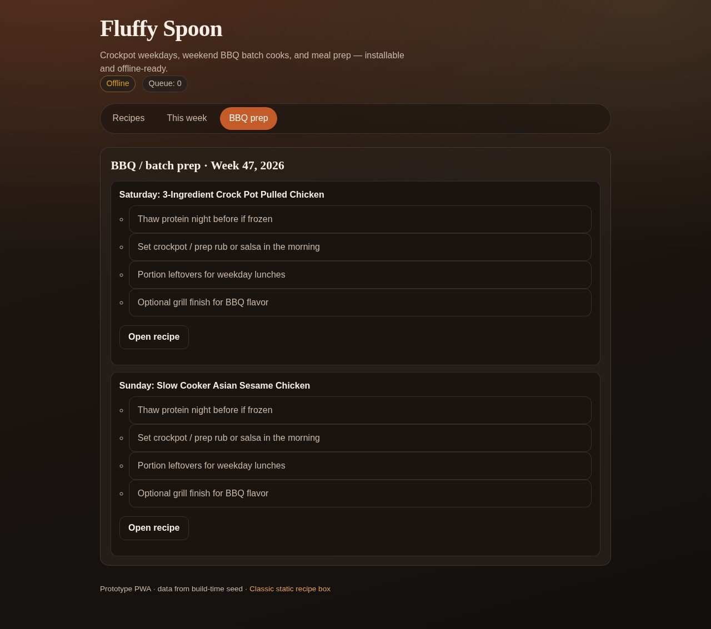

# Fluffy Spoon — PWA demo

Installable, offline-capable recipe / meal-plan app (Svelte + Vite + vite-plugin-pwa).

## Local happy path

```bash
# From repo root
python3 -m venv .venv && .venv/bin/pip install -r requirements.txt   # optional, for XML regen
npm run build          # exports seed.json, builds PWA → dist/, copies classic site
npm run preview        # serves Vite preview of dist (or: npm --prefix pwa run preview)

# Dev with HMR (service worker enabled in vite config)
npm run dev
```

Open http://127.0.0.1:4173/ (preview) or the Vite dev URL.

- **Recipes** — search/filter from IndexedDB (hydrated from `/data/seed.json`)
- **This week** — ISO week from the 52-week seed; **Mark cooked** queues offline mutations
- **BBQ prep** — weekend batch tasks for the selected week
- **Classic** — `/classic/recipe-box.html` for the legacy static cookbook

### Offline check

1. Load the app once online (SW + seed hydrate).
2. DevTools → Network → Offline (or `playwright` E2E).
3. Reload — shell, recipes, week, and BBQ prep still render.

### Windows install (manual)

1. Deploy or use HTTPS / localhost in Edge or Chrome.
2. Install this site as an app → Start menu / taskbar entry → standalone window.
3. (Aspirational automation — not covered by CI.)

## Vercel

Root `vercel.json`:

- Build: `npm run build`
- Output: `dist`
- Install: pip (optional) + `cd pwa && npm install`
- `/` → PWA; `/classic` → legacy recipe-box

After merge to the branch Vercel tracks, set the production URL here:

| Env | URL |
|-----|-----|
| Production | _(set after first successful Vercel deploy of this branch)_ |
| Classic | `{production}/classic/recipe-box.html` |

Turn off Deployment Protection for Production if you need a public demo without SSO.

## Screenshots



Generated by `npm run test:e2e` (Playwright offline scenario).

## Specs & beads

- OpenSpec change: `openspec/changes/pwa-offline-windows-app/`
- Beads map: `BEADS.md` (`bd ready`)
- E2E: `pwa/e2e/offline-recipe.spec.ts`
